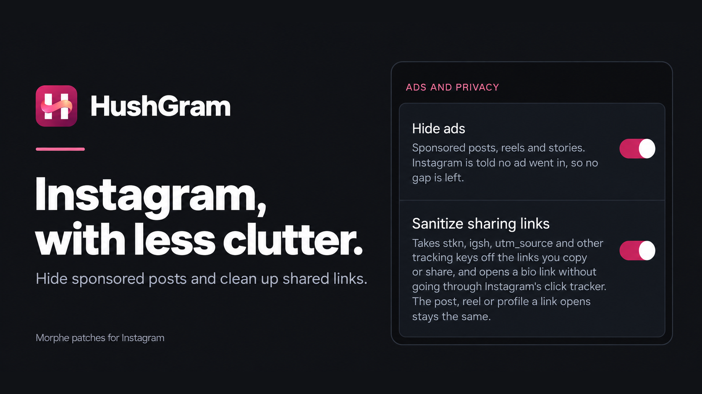
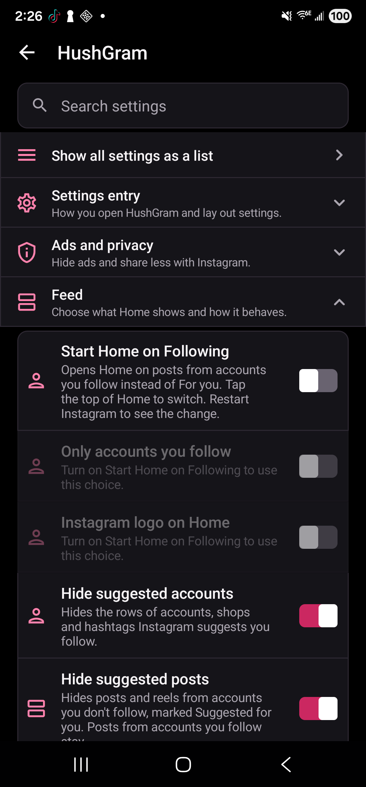
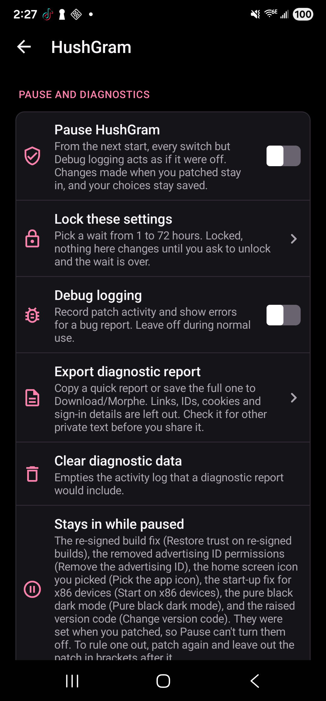
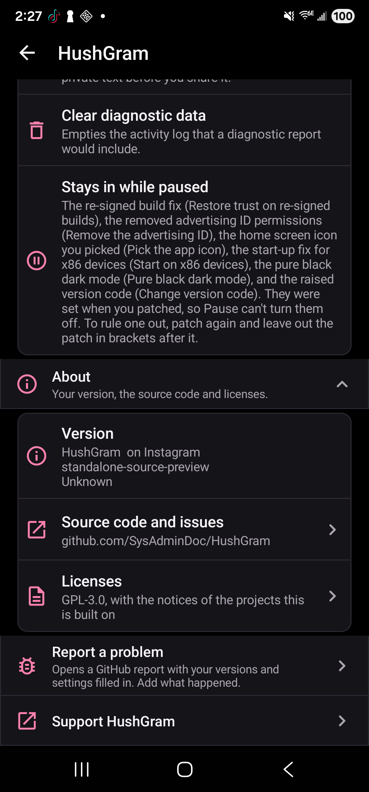

<p align="center">
  
  <a href="LICENSE"></a>
  
  
  
</p>

<p align="center">
  <a href="https://ko-fi.com/X8K126YVER">
    
  </a>
</p>

<p align="center">
  <sub><em>If HushGram makes Instagram better for you, a coffee helps me keep testing patches and maintaining them as Instagram changes.</em></sub>
</p>

#  HushGram

HushGram is a set of [Morphe](https://morphe.software) patches for Instagram on Android. You bring the Instagram APK, Morphe Manager patches it on your phone, and you get an Instagram with a settings screen full of switches the stock app doesn't have. Hide ads, suggested posts and Meta AI. Strip tracking tags from the links you share. Watch stories and lives without landing on the viewer list. Save reels, stories, photos and voice messages, lock your chats, rearrange the tab bar and a lot more.

Most switches start off, so a freshly patched Instagram looks like Instagram until you turn something on. It's the Instagram member of a small family. [Hushfacebook](https://github.com/SysAdminDoc/Hushfacebook) does the same job for Facebook, and HushGram is built on its foundation.

The latest release is [v0.0.17](https://github.com/SysAdminDoc/HushGram/releases/tag/v0.0.17), with 123 patches. Add it to Morphe Manager with [this link](https://morphe.software/add-source?github=SysAdminDoc%2FHushGram).

What changed in each version is in the [changelog](CHANGELOG.md).

This project has no connection to Meta or to the Morphe project. Neither endorses it, and neither wrote it.

## Install

1. Install [Morphe Manager](https://github.com/MorpheApp/morphe-manager) 2.3.0 or newer.
2. Add HushGram as a patch source by opening [this link](https://morphe.software/add-source?github=SysAdminDoc%2FHushGram) on your phone. Or in Manager open **Sources**, tap **+**, choose **Remote** and enter `github.com/SysAdminDoc/HushGram`. Use HushGram as your only Instagram source, since mixing in another one can stop patching.
3. Get Instagram 453.0.0.57.79 from APKMirror. Take [the bundle labelled (arm64-v8a) (480-640dpi) (Android 9.0+), build 385914557](https://www.apkmirror.com/apk/instagram/instagram-instagram/instagram-453-0-0-57-79-release/). The version's other builds work too (see [Supported Instagram builds](#supported-instagram-builds)).
4. Uninstall the Instagram you got from the Play Store. The patched app is signed with your own key, so Android won't install it over Meta's. Uninstalling signs you out, so have your password and two-factor codes ready. On a rooted phone, Manager's Root Mount can lay HushGram over the Play Store app instead, and you stay signed in.
5. In Morphe Manager, pick the Instagram file, keep the default patch selection or change it, and patch.
6. Open HushGram settings and turn on what you want. It's at the top of Instagram's Settings and activity. A long press on the Instagram logo at the top of your feed opens it too.

Prefer a local source? Download the `.mpp` file from the [latest release](https://github.com/SysAdminDoc/HushGram/releases/latest) and add it through **Sources > + > Local**. It won't update itself, and it's a patch bundle, not an Instagram APK.

When a patch can't find its target in your Instagram file, patching stops with a message saying what's missing instead of handing you an app that quietly does nothing. Please report a stop like that.

Android's developer verification doesn't touch a patched Instagram yet. Since September 30, 2026, it only covers installs from a few participating stores in Brazil, Indonesia, Singapore and Thailand. Google plans to bring it to every certified phone in 2027. The patched app is signed with your own key, which no developer has registered, but you won't need to register anything. Once it reaches your phone, turn on Android's advanced flow (a one-time setup that makes you wait a day before you confirm it's you), then tap **Install Anyway** at the warning. When Android asks how long to keep it on, pick indefinitely rather than 7 days, because updates to unregistered apps fail once it's off. Installs over ADB aren't affected. Google's [verification FAQ](https://developer.android.com/developer-verification/guides/faq) has the details.

## Before you sign in

> [!WARNING]
> Meta's [Terms of Use](https://help.instagram.com/581066165581870) don't allow modified versions of its apps, and Meta can disable accounts that break them. Nobody outside Meta knows what gets an account suspended, so nobody can promise yours won't be.
>
> - **Assume Meta can tell.** A patched Instagram has a different signing certificate, and Instagram 453 carries Play Integrity and Keystore attestation code. `Restore trust on re-signed builds` keeps parts of the app working on a re-signed build, but it doesn't make the APK Meta-signed.
> - **Try a spare account first** if you'd rather not put the one you care about on the line. People whose accounts were suspended on patched Instagram often describe a new or long-idle account signing in on a fresh install. That's what they saw, not a proven cause.
> - **Keep the sign-in you have.** Update over the top with the same signing key, or use Root Mount on a rooted phone, rather than starting fresh each time.
>
> HushGram doesn't post, like, follow or message for you, and it doesn't change how you sign in. It also leaves out Instagram Plus, saving deleted messages, saving the Instants people send you and keeping copies of stories after they expire. Other Instagram mods offer those. People using piko's Instagram patches have reported banned accounts, and I suspect features like these may be part of the reason. Nobody has proven it, so leaving them out is a precaution.

## Keep your signing key

Morphe Manager signs the patched Instagram with a key it makes on your phone, and Android only installs an update over your copy when the update carries that same key. With the same key your sign-in and data survive every update.

Back it up right after your first patch. In Morphe Manager open **Settings → System → Import & export → Signing key**, tap **Export** and keep the `Morphe.keystore` file somewhere private, since anyone who has it can sign an APK your phone will take as an update. On a new phone, import it before you patch anything. A different key means uninstalling the patched Instagram first, which deletes its data and signs you out. Morphe's own guide is [Backup and keystore](https://github.com/MorpheApp/morphe-manager/blob/main/docs/backup-and-keystore.md).

## Patches

There are 135 patches for `com.instagram.android`, checked against Instagram 453.0.0.57.79. Manager's simple mode includes 131 of them, so you don't need Expert mode to get any feature below. A patch that comes in this way changes nothing until you turn its switch on in HushGram settings, and each description says where that switch is. A few start on: Hide ads, Sanitize sharing links, Open links in external browser, Remove build expired popup, Hide suggested posts, Hide suggested stories, Hide Meta AI's search and posts switches, Show if a profile follows you, Download any reel, Download any story and Keep the reel speed. Story ring size and Default playback quality start on too, but they keep Instagram's own size and quality until you pick one. Tab bar layout has no switch at all and keeps the bar Instagram gives you until you pick another.

Four patches stay out of simple mode. Tick them in Manager's patch list (Expert mode, then **Choose patches**) if you want them:

- **Change version code** raises the version code for good. Going back means uninstalling Instagram, and every later HushGram build needs it too.
- **Install next to Instagram** makes the build a second app with its own package, data and sign-in (see [Two Instagrams on one phone](#two-instagrams-on-one-phone)).
- **Pure black dark mode** rewrites Instagram's colors when you patch and has no switch to turn it off.
- **View DM photos and videos anonymously** is a test feature until the sender's side is checked with two accounts.

In Expert mode the patches are grouped under Ads, Ghost mode, Privacy, Messages, Feed, Stories, Reels, Playback, Interaction, Profiles, Interface, Downloads, Updates, Fixes and Settings, and most of those match a section in HushGram settings.

| Patch | What it does | Simple mode |
|---|---|---|
| `Accent color` | Swaps Instagram's blue on Follow buttons, links and other highlights for purple, pink, red, orange, green, teal or your wallpaper's colors (Material You, on Android 12 and newer). Restart Instagram to see a change. Starts off. Turn it on in HushGram settings > Layout. | Included |
| `Allow screenshots` | Lets you take screenshots and record your screen where Instagram normally blocks it, such as disappearing photos and videos in chats. Starts off. Turn it on in HushGram settings > Messages. | Included |
| `Ambient light` | Puts a soft glow in a post's own colors around its photo or video in Home and Following, and in the bands around a reel that doesn't fill the screen. The glow follows a video as it plays, and you pick how far it spreads and how fast it changes. A second switch fills the bands above and below a story that doesn't fill the screen. Both start off. Turn them on in HushGram settings > Feed and Stories. | Included |
| `Ask before a call` | Asks you to confirm before a call starts from a chat, so a stray tap on the call button doesn't ring anyone, and can take the call buttons off the top of a chat. Both start off. Turn them on in HushGram settings > Messages. | Included |
| `App-only proxy` | Sends Instagram through an HTTP proxy you set, without changing the proxy for other apps or the phone. You need to set a server too. Starts off. Turn it on in HushGram settings > Ads and privacy. | Included |
| `Ask before a like` | Asks you to confirm before the Like button under a post likes or unlikes it, so a stray tap doesn't do it for you. Starts off. Turn it on in HushGram settings > Feed. | Included |
| `Ask before a refresh` | Asks you to confirm before pulling down refreshes Home, Reels or another list, so an accidental pull doesn't replace what you were reading. Starts off. Turn it on in HushGram settings > Feed. | Included |
| `Back leaves Home` | Makes Back on Home leave Instagram at once, instead of first scrolling the feed to the top and reloading it. Starts off. Turn it on in HushGram settings > Feed. | Included |
| `Blur the bars around Reels` | Shows a blurred copy of a reel above and below it, or beside it, where Instagram would leave black bars. Starts off. Turn it on in HushGram settings > Reels. | Included |
| `Carousel arrows` | Puts a back and a next arrow on a post's carousel in Home and Following, so a tap moves to the next photo or video without a swipe, and can move its page dots onto a round pill over the photo. Both start off. Turn them on in HushGram settings > Feed. | Included |
| `Change the like animation` | Lets you pick the animation that plays when you double tap a post to like it. The choices are animations Instagram made for its Rings creators. Starts off. Turn it on in HushGram settings > Reels. | Included |
| `Change version code` | Stops Google Play from offering Meta's updates over your patched Instagram. Going back to the normal Instagram later means uninstalling first, which deletes its data. Later HushGram builds need this patch too. Works as soon as you patch it in, with no switch. | Opt-in |
| `Clean up Reels` | Hides extra buttons and prompts on reels, such as Follow, Edits, templates, Meta AI, Ray-Ban Meta glasses, friends' activity, the Add a comment bar, the reply bar on reels from chats, the Save button, the Create and Your algorithm buttons, the Friends tab and the Reels tab's top bar. Each one has its own switch, and Burn-in guard can dim a reel's buttons while you aren't touching the screen. Keep clear mode on carries Instagram's clear mode to the next reels, and can start every reel in it. Starts off. Turn it on in HushGram settings > Reels. | Included |
| `Clear the media cache` | Frees storage by deleting Instagram's saved copies of photos and videos once they pass 500 MB. Your sign-in, drafts and settings stay. A row clears them right away. Starts off. Turn it on in HushGram settings > Storage. | Included |
| `Control taps and volume on Reels` | Lets you choose what a single tap on a reel does: Instagram's default, pause, or mute. Can also keep a reel muted when you press volume up. Both start at Instagram's behavior. Choose them in HushGram settings > Playback. | Included |
| `Copy comment` | Adds Copy and Copy username to the menu you get on a comment, so you can copy its text or the commenter's username. Starts off. Turn it on in HushGram settings > Comments. | Included |
| `Default playback quality` | Plays videos, reels and video stories at the quality you choose, instead of the one Instagram picks as it plays. Nothing changes until you pick a quality. On by default. Turn it off in HushGram settings > Playback. | Included |
| `Data saver` | Saves mobile data by loading smaller photos and starting videos at the lowest quality. It uses Full resolution photos and Default playback quality, so it turns both on. It starts with mobile data only. Starts off. Turn it on in HushGram settings > Playback. | Included |
| `Don't save recent searches` | Keeps the accounts and tags you open from search out of your Recent list. Searches already in Recent stay until you clear them. Starts off. Turn it on in HushGram settings > Explore. | Included |
| `Show all recent searches` | Lists every recent search under the search bar instead of the first few. See all and the x on each row work as before. Starts off. Turn it on in HushGram settings > Explore. | Included |
| `Don't report screenshots` | Stops Instagram from telling people when you take a screenshot of their disappearing photo or video. Ghost mode, at the top of Ads and privacy, turns it on with the others. Starts off. Turn it on in HushGram settings > Messages. | Included |
| `Don't send reel watch history` | Stops Instagram from learning which reels you watched and how far you got. Reels you've already watched may come back. Starts off. Turn it on in HushGram settings > Reels. | Included |
| `Download any reel` | Adds Download to the menu of every reel and saves it without Instagram's watermark. You choose the quality, and best is the default. A separate Download cover switch also saves the reel's cover picture, the largest one the post carries, and Download audio saves just its sound. Download as video on a carousel with music saves every page, in order. A separate switch under Downloads puts a download icon under Save beside each reel, and another adds a Lens icon for copying a reel's text. On by default. Turn it off in HushGram settings > Reels. | Included |
| `Download any story` | Adds Download to the menu of anyone's story. Videos save at the quality you choose and photos at their largest size, and Download as photo saves a still from a video story. A Download button at the top of a story is a separate switch, off to start, and so is a Copy text button that opens Google Lens on the story. Turn them on or off in HushGram settings > Stories. | Included |
| `Download any video` | Adds Download to video posts in your feed, saving the video without Instagram's watermark. Other switches add Download for photos, Download cover, a Details row with the post's time and poster, a download icon beside Save under each post, and Hold to download, which saves a post or reel you hold two fingers on. Download all waits its turn, with up to ten posts queued, so two posts' pages never mix in your gallery. Starts off. Turn it on in HushGram settings > Downloads. | Included |
| `Download voice messages` | Adds Save to the menu you get when you hold a voice message in a chat. It saves the recording as an audio file. Starts off. Turn it on in HushGram settings > Downloads. | Included |
| `Emoji style` | Shows every emoji in Google's style instead of your phone's own, or in a free emoji pack (Twemoji, OpenMoji, Blobmoji) or a color emoji font file you pick. The full change shows after you restart Instagram. Starts off. Turn it on in HushGram settings > Layout. | Included |
| `Explore without personalization` | Where Instagram lets you turn off personalization in Explore (in the EU), opens Explore on the grid that isn't personalized every time and keeps it from switching back after ten minutes. A second switch hides the menu button for it. Both start off. Turn them on in HushGram settings > Explore. | Included |
| `Find the reel you came from` | Open a creator's profile from a reel, then their Reels tab, and it scrolls to that reel and outlines it for a moment. A photo reel is found in their posts. Stop looking ends the search, and Wait for a tap to find it holds it until you tap Find the reel. Starts off. Turn it on in HushGram settings > Reels. | Included |
| `Font` | Lets you pick the font Instagram's text uses: Instagram's own, your phone's, or a .ttf or .otf file. Restart Instagram to see a change. Starts on Instagram's font. Pick one in HushGram settings > Layout. | Included |
| `Full resolution photos` | Loads photos in the largest size Instagram sends instead of one picked for your screen. A second switch asks for a larger size on screens under 1440 pixels wide, and a third gets reel covers and grid pictures at full size. Uses more data. Starts off. Turn it on in HushGram settings > Feed. | Included |
| `Full screen Reels and Home` | Hides the status bar and the navigation bar while Reels shows, and optionally while Home or your messages do. Swipe in from the edge to bring them back for a moment. Back and the keyboard work as usual. Starts off. Turn it on in HushGram settings > Reels (Full screen Reels), Feed (Full screen Home) and Messages (Full screen Messages). | Included |
| `Glass tab bar` | Draws the tab bar as a floating, rounded pill of frosted glass that blurs what's behind it (Android 12 and newer), with a highlight on the tab you're on. Content can optionally run down behind it. Starts off. Turn it on in HushGram settings > Tab bar, then restart Instagram. | Included |
| `Group Instagram's notifications` | Puts Instagram's notifications in one group, or in a group for each type, so they don't fill your notification shade. Tapping one still opens it. You can also mute the types you pick, like promo pushes. Starts off. Turn it on in HushGram settings > Notifications. | Included |
| `Hide ads` | Hides sponsored posts, reels, stories and the ad in comments, and leaves no gap where an ad would have been. On by default. Turn it off in HushGram settings > Ads and privacy. | Included |
| `Hide AI-labeled reels` | Leaves out reels that carry Instagram's own AI label. A reel without that label stays. Starts off. Turn it on in HushGram settings > Reels. | Included |
| `Hide captions` | Takes the caption off posts in your feed and off reels. The post stays, and the comments sheet still shows it. Starts off. Turn it on in HushGram settings > Feed. | Included |
| `Hide comments` | Takes the Comment button and the comment count off posts in your feed. Starts off. Turn it on in HushGram settings > Comments. | Included |
| `Hide Follow on feed posts` | Takes the Follow and Subscribe buttons off the top of posts in your feed. The name, time and menu stay. Starts off. Turn it on in HushGram settings > Feed. | Included |
| `Hide Follow on stories` | Takes the Follow button off the top of stories from accounts you don't follow. The name, time and menu stay. Starts off. Turn it on in HushGram settings > Stories. | Included |
| `Hide group buttons on the share sheet` | Takes the New group button and the button that sends to several people as a group off the share sheet, and lets you pick which of the round buttons under the people it shows. You can still start a group from your messages. Both start off. Find them in HushGram settings > Sharing. | Included |
| `Hide highlights` | Takes the row of story highlights off profiles, yours and other people's. Bios, counts and posts stay. Starts off. Turn it on in HushGram settings > Profiles. | Included |
| `Hide profile tabs` | Lets you take the Reels, Reposts and Tagged tabs off profiles, yours and other people's, and keep the grid. Starts with every tab showing. Pick which to hide in HushGram settings > Profiles. | Included |
| `Hide Instants` | Takes the stack of Instants out of your messages. Instants is Instagram's no-edit camera for sharing quick photos with friends. Starts off. Turn it on in HushGram settings > Messages. | Included |
| `Hide Meta AI` | Removes Meta AI from Instagram's search bars, messages, home top bar, reels menus, share sheet and feed. Each part has its own switch. The search one and the Meta AI posts one start on, the rest start off. Change them in HushGram settings > Meta AI. | Included |
| `Hide Notes on profile pictures` | Takes the Notes bubble off profile pictures, yours included. Notes in Messages stay. Starts off. Turn it on in HushGram settings > Profiles. | Included |
| `Hide Reels in the feed` | Removes the rows of suggested reels from your home feed. A reel posted by someone you follow stays. Starts off. Turn it on in HushGram settings > Reels. | Included |
| `Hide the home feed` | Empties your home feed on purpose, so Home shows only the stories row. Profiles, Explore and Reels still show posts. Starts off. Turn it on in HushGram settings > Feed. | Included |
| `Hide the Explore grid` | Empties the grid of posts and reels on the Search tab. Search, recent searches and results stay. A second switch hides the suggested accounts that show when you tap the search bar. Starts off. Turn it on in HushGram settings > Explore. | Included |
| `Hide paid partnership Reels` | Leaves out reels with a Paid partnership label, and reels Instagram marks as boosted. Ads have their own switch. Starts off. Turn it on in HushGram settings > Reels. | Included |
| `Hide reels by caption words` | Leaves out reels whose caption holds a word or phrase from your list, and Home's posts too with Also on Home. Starts off. Turn it on and type the words in HushGram settings > Reels. | Included |
| `Hide rows in Instagram's settings` | Lets you take the rows you don't use off Instagram's own Settings and activity screen. Open that screen once, then untick rows in HushGram settings > Layout > Rows in Instagram's settings. Every row shows to start. | Included |
| `Hide suggested accounts in DMs` | Takes the Accounts to follow section off the bottom of your messages. Your chats and follow requests stay. Starts off. Turn it on in HushGram settings > Messages. | Included |
| `Hide suggested accounts in Reels` | Leaves out the cards of accounts to follow that Instagram puts between reels. Every reel still plays. Starts off. Turn it on in HushGram settings > Reels. | Included |
| `Hide suggested people on profiles` | Takes Suggested for you and the Discover people button off profiles. Bios, counts and posts stay. More switches take Suggested for you off the follow lists and their Suggested tab, the Complete your profile cards off your own profile, and People you don't follow back, suggested threads and people, and the Featured section off your notifications. Starts off. Turn it on in HushGram settings > Profiles. | Included |
| `Hide suggested posts` | Removes posts from accounts you don't follow, suggested accounts, surveys and shopping rows from Home. It also takes shop tiles out of Explore and the shopping bag off posts with tagged products. Posts from accounts you follow stay. Extra switches can also hide the 'Are you interested in this post?' question on Home and Reels, the caught up card, all videos, photos, carousels, posts you've liked or posts from accounts you pick. A post's menu has Hide posts from this account to add one to that list, and those posts leave Home on the next refresh. On by default. Turn it off in HushGram settings > Feed. | Included |
| `Hide suggested stories` | Removes stories from accounts you don't follow from the row at the top of Home. More switches hide rewinds and memories, keep only verified or unverified accounts, or hide the whole row. Starts on. Turn it off in HushGram settings > Stories. | Included |
| `Hide that you're typing` | Stops the people you're chatting with from seeing when you're typing. You still see when they type. Ghost mode, at the top of Ads and privacy, turns it on with the others. Starts off. Turn it on in HushGram settings > Messages. | Included |
| `Hide the comment emoji row` | Takes the row of quick emoji off above the comment box. The box itself stays. Starts off. Turn it on in HushGram settings > Comments. | Included |
| `Hide the notes row` | Takes the row of notes, and the Map bubble in it, off the top of your messages. Your chats stay. Starts off. Turn it on in HushGram settings > Messages. | Included |
| `Hide the Reels tab` | Takes the Reels tab off the tab bar. Reels in your feed and reels people send you still open. A second switch, Show the Reels tab, puts it back after Home when Instagram built your bar without one, and Hide wins if both are on. Restart Instagram to see the change. Starts off. Turn it on in HushGram settings > Reels. Under Tab bar, switches do the same for Home, Search, Create, Messages and Profile, two put Messages or Activity on the bar when Instagram left them off, switches take the Create and notifications buttons off Home's header, others add a Search, Messages or Ghost mode button to it or put Instagram's logo in its middle, two center the name at the top of profiles and the title on other screens, a list puts the tabs in your order, and another picks the tab Instagram opens on. | Included |
| `Hide the Repost button` | Takes the Repost button and its count off posts and reels, so nothing gets reposted by mistake. Share still works. Starts off. Turn it on in HushGram settings > Sharing. | Included |
| `Hide the search bar in Messages` | Takes the search bar and its Filter button off the top of your messages, the Meta AI bar too. Your chats and notes stay. Starts off. Turn it on in HushGram settings > Messages. | Included |
| `Hide the Share button` | Takes the Share button and its count off posts in your feed and off reels. Starts off. Turn it on in HushGram settings > Sharing. | Included |
| `Hide the Threads button` | Takes the Threads button off the top of profiles, with switches for the Create button and Share profile on your own, and Subscribe and the arrow after the buttons on creators' profiles. The menu and the other buttons stay. Each starts off. Turn them on in HushGram settings > Profiles. | Included |
| `Hide your active status` | Stops people from seeing Active now for you while you use Instagram. You still see when they're active. Ghost mode, at the top of Ads and privacy, turns it on with the others. Starts off. Turn it on in HushGram settings > Messages. | Included |
| `HushGram launch screen` | Shows HushGram's logo instead of Instagram's on the screen you see while Instagram starts, on Android 13 and newer. Starts off. Turn it on in HushGram settings > Layout. | Included |
| `HushGram settings` | Adds a HushGram settings page to Instagram. Open it by long-pressing the Instagram logo at the top of your feed or Instagram's icon, or from the top of Settings and activity. Turn features on or off there, pause HushGram and save diagnostics. Works as soon as you patch it in, with no switch. | Included |
| `Install next to Instagram` | Installs this build as a second Instagram beside your normal one, with its own data and sign-in. Pick its package name and app name in the patch's options, and whether its icon gets a HushGram badge. Works as soon as you patch it in, with no switch. | Opt-in |
| `Keep a seek bar on Reels` | Keeps a seek bar under every reel, short ones too, with the time played and the reel's length above it, like 0:10 / 0:55. Starts off. Turn it on in HushGram settings > Reels. | Included |
| `Keep Home's top bar` | Keeps the Instagram logo and the buttons beside it at the top of Home while you scroll. A second switch shows your feed blurred under them. Both start off. Turn them on in HushGram settings > Feed. | Included |
| `Keep in chat` | Keeps view once and replayable photos and videos in your chats after you open them, so they don't disappear. A photo or video you send stays Instagram's own sent bubble. Starts off. Turn it on in HushGram settings > Messages. | Included |
| `Chat history tools` | Long press a chat's name to jump to its first message or to a date, or to save the chat as a text file. The chat loads its older messages on its own, with a count and a Cancel button. Both start off. Turn them on in HushGram settings > Messages. | Included |
| `Swipe through a chat's reels` | Swiping up on a reel you opened from a chat goes through the other reels shared in that chat before any suggested reels, and can stop after them. Both start off. Turn them on in HushGram settings > Messages. | Included |
| `Keep Reels auto scroll on` | Keeps Instagram's auto scroll in Reels turned on after you leave Reels or restart Instagram, until you turn it off yourself. It can also move on to the next reel when one ends on accounts where Instagram doesn't offer auto scroll. Starts off. Turn it on in HushGram settings > Reels. | Included |
| `Keep the reel speed` | Keeps the 2x speed on for the next reels after you lock a reel at 2x (hold its edge, then slide down), until you slide the lock off. On by default. Turn it off in HushGram settings > Reels. | Included |
| `Keep the Reels top bar` | Keeps the Reels title, the Friends tab and the buttons beside them at the top while you swipe through reels. Starts off. Turn it on in HushGram settings > Reels. | Included |
| `Keep your place in Home` | Coming back to Instagram leaves Home on the post you were on, however long you were away, instead of reloading it and jumping to the top. Starts off. Turn it on in HushGram settings > Feed. | Included |
| `Lock your messages` | Covers your inbox and chats, all of Instagram, or just the single chats you pick under Locked chats, until your fingerprint, face or screen lock says it's you. Message notifications only say that a message came. Chats you pick under Hidden chats leave your inbox and their notifications don't post. Starts off. Turn it on in HushGram settings > Messages. | Included |
| `Long press to zoom` | Press and hold a photo in a feed to see it twice as big around your finger, and let go to close it. Pinch to zoom still works. Keep the zoom open leaves it up after you let go, to drag and pinch from 1x to 4x until a tap or Back closes it. While its switch is on, it takes the place of Instagram's own long press on a photo. Starts off. Turn it on in HushGram settings > Feed. | Included |
| `Loop a story` | Plays a story again from the start when it ends, instead of moving on to the next one. Tap or swipe to move on. Starts off. Turn it on in HushGram settings > Stories. | Included |
| `Mark one-time photos and videos` | Puts a border and Instagram's own view once icon on a one-time photo or video in a chat, so you can tell it before you open it. Only how the chat looks changes. Nothing is saved, replayed, marked seen or sent. Starts off. Turn it on in HushGram settings > Messages. | Included |
| `Message box buttons` | Lets you take the gallery, sticker and voice message buttons off the message box of a chat, and keep the text box and Send. Starts with every button showing. Pick which to hide in HushGram settings > Messages. | Included |
| `Open comments without the keyboard` | Comments open with the keyboard down. A tap in the comment box, or on Reply, still brings it up. Starts off. Turn it on in HushGram settings > Comments. | Included |
| `Open links in external browser` | Opens web links you tap in your usual browser instead of Instagram's built-in one, without Instagram's click tracker. Instagram pages and ads still open in the app. On by default. Turn it off in HushGram settings > Ads and privacy. | Included |
| `Pick the app icon` | Lets you pick the icon Instagram shows on your home screen: Instagram's own, HushGram's, Instagram's glyph on black, on plum, or in black on white, or a hand-drawn Instagram glyph on white. The new icon shows once you leave Instagram, and you may need to add it to your home screen again from the app drawer. Starts on Instagram's own. Pick one in HushGram settings > Layout. | Included |
| `Pinch to zoom on Reels` | Lets you zoom into a playing reel with two fingers, the way a photo zooms. Lift your fingers and it goes back. Restart Instagram to see the change. Starts off. Turn it on in HushGram settings > Reels. | Included |
| `Profile posts as a list` | Opening someone's profile takes you on to their posts as a scrolling list of full posts. Back shows the grid. Your own profile keeps its grid. Starts off. Turn it on in HushGram settings > Profiles. | Included |
| `Pure black dark mode` | Makes Instagram's dark mode pure black instead of dark gray, on the menus that slide up from the bottom too. It looks deeper and can save battery on an OLED screen. Buttons keep their grays so they stay easy to see. Works as soon as you patch it in, with no switch. | Opt-in |
| `Read messages without the seen receipt` | Opening a chat no longer tells people you've seen their messages. You still see when they've seen yours. Mark as read still tells them. Ghost mode turns it on too. Starts off. Turn it on in HushGram settings > Messages. | Included |
| `Remove build expired popup` | Stops Instagram from locking you out with a screen that says this version is too old. A patched build can't update itself, so it would stop working after a few weeks. On by default. Turn it off in HushGram settings > Version warnings. | Included |
| `Remove the advertising ID` | Stops Instagram from reading your phone's advertising ID, which ad companies use to follow you between apps. Instagram gets a string of zeros instead. Works as soon as you patch it in, with no switch. | Included |
| `Remove the empty space at the bottom` | Takes away the empty gap Instagram leaves under its tab bar for a navigation bar that isn't there. Restart Instagram to see the change. Starts off. Turn it on in HushGram settings > Layout. | Included |
| `Restore trust on re-signed builds` | Lets Instagram's own checks of who signed the app pass on a patched build, so the parts that need them keep working. Threads, Facebook and Messenger patched with the same key work too. Works as soon as you patch it in, with no switch. | Included |
| `Resume long videos` | A video or reel longer than two minutes picks up where you left off the next time you play it on the same account. Live videos and ads start as usual. Starts off. Turn it on in HushGram settings > Playback. | Included |
| `Rounded post corners` | Rounds the corners of a post's photo, video and carousel pages in Home and Following, and of reels and stories if you like, at a small or large size. Profiles and Explore stay as Instagram draws them. Starts off. Turn it on in HushGram settings > Feed. | Included |
| `Sanitize sharing links` | Removes tracking tags from the links you copy or share, and opens bio links without Instagram's click tracker. The link still opens the same post, reel, story or profile. On by default. Turn it off in HushGram settings > Ads and privacy. | Included |
| `Save comment photo` | Adds Save to the menu on a comment that has its own photo or GIF, saving the largest size Instagram sent. A GIF is saved as a .gif in Pictures/Instagram, taken from Instagram's own copy, not Giphy. If Instagram lists only an animated WebP or an MP4 for it, you get that file instead, and an MP4 goes in Movies/Instagram like a video. It can also add a GIF reply to a comment with a GIF, sending that same GIF back as your reply. Starts off. Turn it on in HushGram settings > Comments. | Included |
| `Save profile picture` | Adds Save profile picture, View profile picture, Copy username and Copy bio to the menu on someone's profile. View opens the picture full screen and lets you zoom. Starts off. Turn it on in HushGram settings > Downloads. | Included |
| `Saved on your profile` | Adds a bookmark to the tabs on your own profile, beside posts, reels and tagged, that opens Saved. Starts off. Turn it on in HushGram settings > Profiles, then restart Instagram. | Included |
| `Show a post's exact time` | Shows the date and time a post went up, like Oct 2, 3:45 PM, instead of how long ago. It does the same for comments. Starts off. Turn it on in HushGram settings > Feed. | Included |
| `Show a reel's exact time` | Adds the date and time a reel was posted under the author's name, like Oct 2, 3:45 PM, with the seconds or how long ago (1d 2h 5m ago) if you want them. Starts off. Turn it on in HushGram settings > Reels. | Included |
| `Show a story's exact time` | Shows the date and time a story was posted, like Oct 2, 3:45 PM, instead of how long ago. A choice under the switch can show the time left instead. Starts off. Turn it on in HushGram settings > Stories. | Included |
| `See who a story mentions` | Adds a small label in a story's header showing how many accounts it mentions. Tap it for a list and tap an account to open their profile. Starts off. Turn it on in HushGram settings > Stories. | Included |
| `Seek bar on feed videos` | Shows a bar along the bottom of the video playing in your feed that you can drag to jump to any point in it. Starts off. Turn it on in HushGram settings > Feed. | Included |
| `Seek bar on stories` | Shows a bar near the bottom of a video story that you can drag to jump to any point in the video. Photos don't get one. Starts off. Turn it on in HushGram settings > Stories. | Included |
| `Show hidden like counts` | Shows how many likes a post or reel has when its owner hid the count, as long as Instagram's server still sends the number. If it doesn't, nothing changes. Starts off. Turn it on in HushGram settings > Feed. | Included |
| `Show if a profile follows you` | Adds Follows you or Doesn't follow you beside the name on someone's profile. Other switches add a chip and mark accounts on your Following list that don't follow you back, and Recent unfollowers shows who left your Followers list. The chip is blue for Follows you, green for Following each other and red for Doesn't follow you, and it can go small under the profile picture. On by default. Turn it off in HushGram settings > Profiles. | Included |
| `Show when someone was last active` | Shows the exact time someone was last on, like Active at 3:42 PM, in your messages and in a chat, instead of Active 3h ago. Active now stays. Starts off. Turn it on in HushGram settings > Messages. | Included |
| `Skip the collections tray` | Saving a post or reel shows Instagram's Saved message instead of the tray that asks you to start a collection. Starts off. Turn it on in HushGram settings > Feed. | Included |
| `Skip the contacts and location popups` | Stops the screens asking you to sync your contacts and turn on location services from opening each time Instagram starts. Nothing else is skipped. Starts off. Turn it on in HushGram settings > Ads and privacy. | Included |
| `Start Home on Following` | Opens Home on posts from accounts you follow instead of For you. A second switch removes For you from Home, and a third keeps Instagram's logo at the top of Home in place of the feed's name. A fourth, Fall back to Following, opens Home on Following for an account whose For you brings only suggested posts, unless you picked a feed. Restart Instagram to see the change. Starts off. Turn it on in HushGram settings > Feed. | Included |
| `Start feed videos with sound` | Starts the first video on Home with its sound on, the same as tapping the video's speaker. Your phone's ringer and volume still count. Starts off. Turn it on in HushGram settings > Feed. | Included |
| `Start on x86 devices` | Stops Instagram from crashing or freezing on x86 devices that run its code through a translator, such as some Chromebooks and emulators. Phones and tablets with arm chips run it as before. Works as soon as you patch it in, with no switch. | Included |
| `Start reels with sound` | A reel you open from a post on Home plays with sound, and Home is muted again when you go back. Your phone's ringer and volume still count. A separate switch, Start reels muted, starts every reel silent instead. Both start off. Turn them on in HushGram settings > Playback. | Included |
| `Start stories with sound` | Opens stories with their sound on, the same as tapping Instagram's speaker. Your phone's ringer and volume still count. Starts off. Turn it on in HushGram settings > Stories. | Included |
| `Stop background wake-ups` | Stops two alarms that wake your phone while Instagram is in the background. One goes off every minute or two only to note that Instagram is still running, and the other wakes it five minutes later to upload usage events. Messages and notifications still arrive. Starts off. Turn it on in HushGram settings > Battery. | Included |
| `Stop Reels scrolling` | Stops a swipe in Reels from moving to the next reel, so you stay on the one you opened. A second switch stops swiping after as many reels as you pick, for as long as you pick, and Take a scroll break covers Home, Reels and Explore for 5 minutes after the time you pick. Starts off. Turn it on in HushGram settings > Reels. | Included |
| `Stop Story auto-advance` | Keeps each story on screen until you tap or swipe. Starts off. Turn it on in HushGram settings > Stories. | Included |
| `Stop swipe to create` | Stops a sideways swipe on Home from opening the camera. The + button still opens it. Starts off. Turn it on in HushGram settings > Feed. | Included |
| `Stop swipe up to reply` | Stops a swipe up on someone's story from opening the reply box and its reactions. Tapping Send message still replies. Starts off. Turn it on in HushGram settings > Stories. | Included |
| `Stop swiping between tabs` | Stops a sideways swipe from moving between Home, Reels and the other main tabs. Tapping the tab bar still works. Starts off. Turn it on in HushGram settings > Feed. | Included |
| `Stop videos looping` | Feed videos and reels stop at their last frame instead of playing again. Reels still loop while auto scroll is on, so it can move on. Starts off. Turn it on in HushGram settings > Playback. | Included |
| `Swipe left to open the profile` | Makes a left swipe on a reel open the profile of the person who posted it, like Instagram used to. Tap Friends at the top to reach your friends' reels. Starts off. Turn it on in HushGram settings > Reels. | Included |
| `Story ring size` | Draws the rings in the stories row at the top of Home smaller, so more fit on screen, or larger, and the ring of a story you haven't watched in a color you pick. Nothing changes until you pick a size or a color. On by default. Turn it off in HushGram settings > Stories. | Included |
| `Smooth story opening` | Opens a story from the stories row with a slower, gentler zoom instead of Instagram's quick spring. Starts off. Turn it on in HushGram settings > Stories. | Included |
| `Thicker story progress bar` | Draws the progress bar along the top of a story twice or three times as thick. Its segments and timing stay as they were. Starts off. Turn it on in HushGram settings > Stories. | Included |
| `Tab bar layout` | Lets you keep the newer tab bar, where you swipe between every tab, or the classic one, instead of the one Instagram picks for your account. Starts on Instagram's choice. Pick one in HushGram settings > Tab bar. | Included |
| `Tap a feed video to pause it` | A tap on the video playing in a feed pauses it in place instead of opening it in Reels, and another tap plays it again. Ads keep Instagram's own tap. Starts off. Turn it on in HushGram settings > Feed. | Included |
| `Tap to play` | Makes videos, reels and stories wait for your tap instead of starting by themselves, like Instagram does when it saves mobile data. A choice under the switch can leave Reels out or hold only Reels. Starts off. Turn it on in HushGram settings > Playback. | Included |
| `Turn off double tap to like` | Stops a double tap on a post or reel from liking it, and the heart doesn't show. The Like button still works. Separate switches cover posts, reels, comments and chat messages. Starts off. Turn it on in HushGram settings > Reels. | Included |
| `Upload stories at full quality` | Sends the video stories you post at 1080p and a higher bitrate, as Instagram does with its own Upload at highest quality setting on. Instagram still shrinks story videos to 720p on its servers, so viewers see a small difference. Starts off. Turn it on in HushGram settings > Stories. | Included |
| `Story text fonts` | Adds fonts you pick from your phone (.ttf or .otf files) to the story text editor alongside Instagram's own fonts, and can draw the emoji in story text from an emoji font file you pick. Starts off. Set both up in HushGram settings > Stories. | Included |
| `Turn off HDR brightness boosts` | Stops HDR photos and reels from making the screen brighter than everything else. Starts off. Turn it on in HushGram settings > Playback. | Included |
| `Use the highest refresh rate` | Asks Android to run Instagram at your screen's fastest refresh rate, at the same resolution, so scrolling looks smoother on a 90 or 120 Hz phone. Some phones keep their own limit for apps. Starts off. Turn it on in HushGram settings > Layout. | Included |
| `View DM photos and videos anonymously` | Holds back the Opened notice for view once photos and videos in messages, so the sender doesn't see you opened them. Ghost mode turns it on too. Starts off. Turn it on in HushGram settings > Ads and privacy. | Opt-in |
| `Spoof location` | Tells Instagram your phone is at a place you pick, for the location sticker, nearby places and maps. Photos keep their own places. You need to pick a place too. Starts off. Turn it on in HushGram settings > Ads and privacy. | Included |
| `View live anonymously` | Keeps you off the viewer list of the lives you watch, so the host isn't told you're there. Your own lives still count their viewers. An optional eye button at the top of a live puts you on that one's list. Ghost mode turns it on too. Starts off. Turn it on in HushGram settings > Stories. | Included |
| `View stories anonymously` | Keeps you off the viewer list of the stories you watch. Replying or reacting still shows you. An optional Mark as seen button lets you choose. Ghost mode turns it on too. Starts off. Turn it on in HushGram settings > Stories. | Included |

The patches with a switch keep it in `HushGram settings`, so Morphe Manager includes that patch whenever any of them is picked. Seven work as soon as they're patched in, with no switch: HushGram settings, Restore trust on re-signed builds, Remove the advertising ID, Start on x86 devices, Change version code, Install next to Instagram and Pure black dark mode. **Set when you patched**, near the bottom of HushGram settings, lists the ones your build has.

Recent unfollowers only updates after your own Followers list loads completely and matches the account's follower count. If the counts disagree, your previous saved list stays. It doesn't make extra requests to fill the gap.

Watched-story sorting leaves your own story and Instagram's special tray entries in place. It moves ordinary watched story rings behind unseen ones when View stories anonymously and Gray out stories you've watched are both on.

## Settings

Inside Instagram, long-press the Instagram logo at the top of your feed. A tap still does what Instagram made it do, and the long press works while HushGram is paused. From your home screen, long-press Instagram's icon and tap **HushGram settings**. Or open **Settings and activity** from the menu on your profile and tap **HushGram settings** at the top. The shortcut works before you sign in too. Under **Settings entry** you can also pick a tab, or your profile's menu button, whose long press opens HushGram. Every way in has a switch there, so you can keep just the one you like. The last one still on can't be turned off.

<p>
  
  
  
</p>

Search is at the top of settings, with **Show all settings as a list** directly below it. Tap a category to expand its controls underneath. Tap it again to collapse them. You can keep several sections open on the same page, or show every setting at once. The controls you see depend on the patches you picked. The screenshots show a native rendering preview of the v0.0.17 settings.

**Search settings** finds controls across all categories by their labels in your phone's language or their English patch names. Clearing the search restores the sections you had open. Rotation keeps those sections and your position. A change that needs a restart shows the action below the list. Place and sharing-domain editors keep an invalid entry open so you can correct it.

PIN forms keep their labels visible and scroll above the keyboard. Next moves to confirmation, and Done submits. Incomplete entries don't spend an attempt. The picture viewer keeps Close and Save below the preview, clear of system bars. Save becomes available after loading.

A few rows to know about:

- **Pause** turns off every feature a switch controls, all at once, without losing your choices. It's the quickest way to tell whether HushGram is behind a problem. Patch-time changes like the removed advertising ID stay in.
- **Ghost mode**, at the top of Ads and privacy, turns the seven switches that keep what you do to yourself on or off together. Each keeps its own switch too. Pressing and holding New message at the top of your inbox does the same.
- **Downloads** go to Movies and Pictures, each in an Instagram folder unless you name another, and voice messages to Recordings (Music before Android 12). **Skip what's already saved** remembers your newest 15,000 saves so the same post isn't saved twice.
- **Download file name** accepts `{shortcode}` for the post's code from its link. Including it applies the template to photos too. Stories and saves without a known post leave that token out.
- **Settings backup** exports your choices to a JSON file and brings them back later, on this install or another. Accounts, signing keys and playback history aren't included.
- **Descriptions behind an info button**, under Settings entry, keeps each switch to its name. Tap the small i beside a name to read what it does. It starts off, and a screen reader always gets the full text.
- **Date in backup file names**, under Settings backup, adds the current date and time to the suggested export name. It starts off.
- **Pause and diagnostics** copies a quick report or saves the full one to Download/Morphe. Links, IDs, cookies and sign-in tokens are left out, but read it over for other private text before you share it. A source build also shows an `hg1:` build identity under Version in About and in the report.

If Instagram crashes within a minute of starting three times in a row, HushGram pauses itself and the status card says why. Turn it back on once you've patched again or left out the patch at fault. A crash in that first minute is kept, so the full report you save under Pause and diagnostics shows what crashed and which patches were on.

## Help

### If something doesn't work

- **Can't find the settings.** Long-press Instagram's home screen icon and tap **HushGram settings**. If there's no way in at all, refresh the source in Manager and patch again.
- **Switches do nothing.** Refreshing a source only downloads patches. The switches live inside the patched app, so patch and install again. Some switches need Instagram restarted, and their description says so.
- **Package conflict or App not installed.** Android won't replace an app with one signed by a different key. Update with the key the installed build used, or uninstall the differently signed app first. That deletes its data, so make sure you can sign in again.
- **Unsupported Version.** Manager is told one 453.0.0.57.79 build per kind of phone (the codes in [Supported Instagram builds](#supported-instagram-builds)), so it says this for a build meant for another kind of phone or any other version. The other screen density builds listed there patch cleanly in HushGram's tests even though Manager calls them unsupported. Anything else may work, but nobody has checked it.
- **Patching stops on one patch.** Check that you're patching a supported build, and if several patch sources are enabled, try HushGram alone. If it still stops, open an issue naming the patch, your Manager version and the error.
- **Patching runs out of memory.** Turn on **Use embedded VM** in Manager's settings and patch again. Instagram's DEX index and resource table can exceed a 256 MB heap before HushGram's patches run. Desktop 1.19.1 passed with a 512 MB heap. That desktop result hasn't been verified on Android.
- **Instagram won't stay open long enough to reach settings.** Create an empty file named `hushgram-safe-mode` in `Android/data/com.instagram.android/files` (a computer or a file manager can reach it). HushGram starts paused until you delete it.
- **The Play Store keeps offering an Instagram update.** Open Instagram's page in the Play Store, tap the three dots at the top right and untick **Enable auto update**. **Change version code** stops the offers for good on a standard install, but read its warning in [Patches](#patches) first.
- **Slow right after a Root Mount install.** Android's compiled copy of Instagram was made from Meta's code, so it runs Instagram uncompiled until it's compiled again. Run this in a root shell (`adb shell` then `su`, or Termux with `su`), reopen Instagram, and run it again whenever you mount a new HushGram build:

  ```
  cmd package compile -m speed-profile -f com.instagram.android
  ```

### Two Instagrams on one phone

`Install next to Instagram` builds a second Instagram that installs beside the one you have, say for a second account. Switch Manager to Expert mode, open **Choose patches** and tick it under Updates. Its options hold the package name (`com.instagram.android.hush` unless you change it), the name under its icon (`Instagram Clone`) and **Mark the icon**, which puts a small HushGram badge on the copy's icon. Keep the package name you picked, because patching again with another one makes a third app instead of updating the second.

The copy has its own data and its own sign-in, and HushGram's settings and downloads come along. Instagram's servers can see its package name when it signs in, and HushGram doesn't hide that.

### Getting help

For something that's broken, use the [bug form](https://github.com/SysAdminDoc/HushGram/issues/new?template=bug_report.yml) and attach the diagnostic report it asks for. Ideas go on the [feature form](https://github.com/SysAdminDoc/HushGram/issues/new?template=feature_request.yml). Questions and setup help go in [Discussions](https://github.com/SysAdminDoc/HushGram/discussions). There's no Telegram or Discord group, so nothing gets lost between places. When Morphe Manager misbehaves with every app, not only Instagram, [Morphe's own tracker](https://github.com/MorpheApp/morphe-manager/issues) is the place.

## Supported Instagram builds

| Field | Value |
| --- | --- |
| Package | `com.instagram.android` |
| Version | `453.0.0.57.79` |
| arm64-v8a builds | `385914557`, for most phones. `385914546` and `385914517` are the same release for other screen densities |
| armeabi-v7a builds | `385914556`, for older 32-bit phones. `385914503` and `385914510` are the same release for other screen densities |
| x86 builds | `385914558`, for emulators and Intel phones. `385914518` is the same release for another screen density. Meta published no x86_64 build of this version, so an x86_64 emulator with an arm translator takes the arm64 build |
| Minimum Android version | Android 9 (API 28) for every ABI |
| Where to get it | [APKMirror](https://www.apkmirror.com/apk/instagram/instagram-instagram/) |

Other Instagram versions haven't been checked. Meta can publish different APKs under one version name, so go by the build number too.

Patching raises the minimum to Android 9 for the armeabi-v7a and x86 builds, which Instagram ships with an Android 8 minimum. HushGram's settings use Android 9 APIs.

Meta signs genuine Instagram builds with one of two certificates, and Morphe Manager warns before it patches an APK signed with any other key. To check a file yourself, run `apksigner verify --print-certs` (from Android's build tools) on the base APK and look for one of these certificate SHA-256 digests:

```text
5f3e50f435583c9ae626302a71f7340044087a7e2c60adacfc254205a993e305  Instagram Inc. (checked by Android 7 to 12L)
3a10c50c18ba937506c2875e9047be74f8fd8b86fae2ff9feaa50a81fcb4c014  Meta Platforms Inc. (checked by Android 13 and newer)
```

## Verify a download

Each [release](https://github.com/SysAdminDoc/HushGram/releases) ships `SHA256SUMS.txt` beside the bundle. Every line is a SHA-256 hash, two spaces and a file name, and it covers the `.mpp` bundle, its SBOM (`.cdx.json`) and the release receipt. Download them from the same tag and compare:

```bash
sha256sum -c SHA256SUMS.txt --ignore-missing
```

On Windows, `Get-FileHash -Algorithm SHA256 .\patches-<version>.mpp` prints the hash to compare with the bundle's line.

## Privacy

HushGram doesn't collect anything and has no server. It opens connections itself in two places. One fetches media you ask for, like a save, a picture you open with View profile picture or the small pictures in See who a story mentions. That all comes over HTTPS from Meta's media servers (`cdninstagram.com`, `fbcdn.net` and `fbsbx.com`), and an address anywhere else is refused. The other downloads an emoji pack when you pick one under Emoji style, once, from its maker's own release on GitHub, and keeps it only if its size and SHA-256 match the file HushGram names. Apart from that, its code names four addresses:

- `github.com`, for the link to this page in settings. It opens in your browser, only when you tap it. The Twemoji and Blobmoji packs download from their release pages there.
- `raw.githubusercontent.com`, where the OpenMoji pack downloads from, only when you pick it.
- `ko-fi.com`, for the Support HushGram row at the end of settings, again only when you tap it.
- `www.instagram.com`, in the link Send downloads to another app hands to the app you pick, and in the profile links See who a story mentions opens inside Instagram.

The diagnostic report stays on your phone until you copy or share it yourself.

## Building from source

You need JDK 17 or newer and the Android SDK. The Morphe patcher comes from GitHub Packages, so you also need a GitHub token with `read:packages`. The build runs on Gradle 9.8.2, Android Gradle Plugin 9.1.0 and Kotlin 2.4.21, with Morphe patcher 2.0.1. Use Morphe Desktop 1.19.1 or newer for local patch checks.

```bash
export GITHUB_ACTOR=<your GitHub user>
export GITHUB_TOKEN=<a token with read:packages>
./gradlew :patches:generatePatchesList
./gradlew :patches:buildAndroid
./gradlew :patches:test :extensions:instagram:testDebugUnitTest
```

The bundle lands in `patches/build/release/patches-<version>.mpp`, beside its SHA-256 and a CycloneDX SBOM. Run `generatePatchesList` before `buildAndroid`, or the bundle loses its Android payload. Set `HUSHGRAM_FIXTURE_DIR` to a folder of stock Instagram builds to run the tests that read real ones. Without it they skip and say so. To apply every patch to a real build and compare the patched manifest with Meta's, run `scripts/verify-all-patches.ps1 -Apk <instagram .apks> -DesktopJar <morphe-desktop jar> -WorkDir <scratch folder>`.

[CONTRIBUTING.md](CONTRIBUTING.md) covers the checks, the pre-push hook and the release steps.

For local phone builds, `scripts/patch-for-device.ps1` accepts `-Keystore` and `-KeyAlias`. Use `-KeystorePassword ''` for an empty store password. A separate key password can come from `HUSHGRAM_SIDELOAD_KEY_PASSWORD` or `-KeyPassword`; otherwise it uses the store password. Passwords go through a temporary argument file that is removed when patching exits. Keep the installed app's signing key so updates preserve its data.

Release walkthroughs use PowerShell 7.5 or newer and the Android SDK. `scripts/walk-app.ps1` checks Home, Explore, Reels, the inbox, your profile and the settings sections included by the catalog. Each visit needs visible content and its own XML and PNG evidence. It checks the installed APK before and after the walk. A loading screen, covered page or shortened visit can't earn a full PASS.

To walk an already installed candidate, pass `-SkipPatch -SignedApk <signed.apk> -Report <result.json> -Record <patch-record.json>` along with the device's `-Serial` and `-ExpectedModel`. Those files must come from that bundle's patch run. The tool updates a separate capture test app with the supplied signing key and preserves Instagram's data and settings. Receipts and captures stay in the output folder. Old receipts without this evidence aren't accepted for publication. A passing walk still needs explicit release authorization.

### Where things live

- `patches/src/main/kotlin/app/morphe/patches/instagram/` holds the patches, grouped by feature area. `misc/extension/` has the target lookup and hook helpers they share, and `shared/compat/AppCompatibilities.kt` names the supported build and Meta's signing certificates.
- `extensions/instagram/` is the Java code that runs inside Instagram, called from the injected hooks. `extensions/shared/library/` has the settings screen, storage, translations and diagnostics.
- `patches/src/test/kotlin/` and `extensions/instagram/src/test/java/` hold the patch and runtime tests.
- `fixtures/` is where local Instagram APKs go. They're large and ignored, so keep them out of commits.
- `sources/instagram-sources.json`, `provenance.json` and `NOTICE` record where code came from, under which license, and the notices the bundle carries.
- `patches-list.json` is the generated patch catalog, so don't edit it by hand. `patches-bundle.json` is the Morphe source index and only changes in a release's index commit.

### Establishing a factory baseline

When a patch depends on how Instagram behaves on its own, compare against the original Meta-signed package for the exact build. Check the version name and build code, verify the base APK's certificate with `apksigner verify --print-certs` against the digests in [Supported Instagram builds](#supported-instagram-builds), and install it with its matching splits on a clean emulator profile with no Morphe bundle applied. Record the Android version, ABI, display density, Instagram build, locale and signed-in state with each observation, and keep those results separate from anything seen on a HushGram build. Turning every HushGram switch off still leaves the patches' hooks in the app, so it isn't a stand-in.

### Translating HushGram

Translations live in UTF-8 TSV files under `extensions/shared/library/src/main/l10n`, with the English text as the lookup key. `scripts/crowdin-l10n.py` prepares review worksheets, `scripts/sync-l10n.py import` brings a reviewed file back, and `scripts/gen-l10n.py` regenerates the class the extension carries. They need Python 3.12 or newer. The [translation guide](docs/translations.md) has the whole workflow and the review rules.

The tables cover German, Spanish, Indonesian, Italian, Korean, Brazilian Portuguese, Turkish and Traditional Chinese (Taiwan). JhouHank contributed the Traditional Chinese table in [#313](https://github.com/SysAdminDoc/HushGram/pull/313). Traditional Chinese script preferences and Hong Kong or Macao locales use its Taiwan wording. Explicit Simplified Chinese keeps the existing fallback.

## Where the patches come from

| Source | What came from it |
|---|---|
| [SysAdminDoc/Hushfacebook](https://github.com/SysAdminDoc/Hushfacebook) at `c15d4f7` | The Gradle build, the shared extension library with its settings screen, pause and diagnostics, the bytecode helpers, the link cleaner, the launcher shortcut and the checks that apply every patch to a real Instagram build. |
| [SysAdminDoc/Hushfacebook](https://github.com/SysAdminDoc/Hushfacebook) at `3a47363`, `814acd2` and `830f949` | The video and photo save pipeline behind the Download patches, the tap clock and start rule behind Tap to play, the saved points and resume rule behind Resume long videos, and the quality ladder and setting behind Default playback quality. |
| [andrewliang25/morphe-patches](https://github.com/andrewliang25/morphe-patches) at `5db2e57`, by way of Hushfacebook | The fix for re-signed builds, pointed here at Instagram's own two signing certificates, and Open links in external browser, pointed at Instagram's in-app browser. |
| [SysAdminDoc/hushfeed](https://github.com/SysAdminDoc/hushfeed), [tiktok-patches-for-morphe](https://github.com/icysymmetra/tiktok-patches-for-morphe), [Morphe](https://github.com/MorpheApp) and [ReVanced](https://gitlab.com/ReVanced/revanced-patches) | Where Hushfacebook's foundation came from: the patcher, the patch template and the shared library. |

The patches themselves, and the Instagram side of the ported features, were written here. Every source file says where it came from in its header, and [provenance.json](provenance.json) maps each file to the project and commit it came from, with its licence. [docs/sources.md](docs/sources.md) covers the other Instagram patch sources and what each one does, and its ledger, [sources/instagram-sources.json](sources/instagram-sources.json), pins each source's licence.

The emoji packs in `Emoji pack` aren't part of HushGram. Each one downloads from its maker when you pick it, and HushGram checks it against the exact file before using it. [Twemoji](https://github.com/mozilla/twemoji-colr) is Twitter's art under CC BY 4.0, made into a font by Mozilla. [OpenMoji](https://github.com/hfg-gmuend/openmoji) is CC BY-SA 4.0 and [Blobmoji](https://github.com/C1710/blobmoji) is Apache 2.0.

## License

[GPL-3.0](LICENSE), with the Morphe section 7 notices carried in [NOTICE](NOTICE). Instagram, Facebook and Meta are trademarks of Meta Platforms, Inc.
